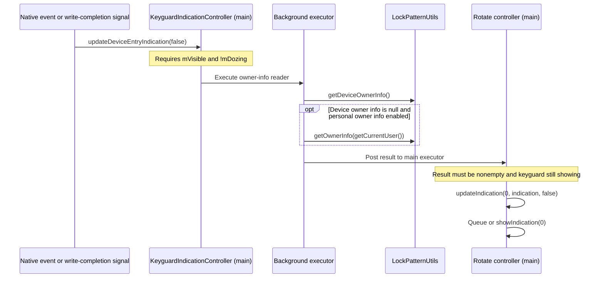

# Keyguard owner-info refresh events and injection points

Examined on 2026-11-14 through Jadx MCP: `com.android.systemui`, manifest
`versionName=17`, `versionCode=37`, compile/min/target SDK 37. This is static
analysis of the loaded APK, with the controller's visibility/Doze branches and
owner-info task dispatch cross-checked against smali. No device validation or
production hook changes have been made. Older SystemUI versions need separate
member checks. The related issue is `TODOS.md`, lock-screen signature (line 69
at the time of investigation).

## Finding

The refresh entry point is:

```text
com.android.systemui.statusbar.KeyguardIndicationController
    updateDeviceEntryIndication(boolean): void
```

For a visible, non-dozing indication area, it schedules a background read of
LockPatternUtils and then submits owner info to the main-thread indication
controller. There is no dedicated `updateOwnerInfo()` method in this APK.
The boolean parameter controls the urgency of the battery indication; passing
`true` does not make owner info urgent.

For reliable refresh after an asynchronous quote request, notify SystemUI
**after a successful owner-info write**, then call this entry point on the
main thread. A screen-on trigger alone cannot order the read after the write.
This establishes a refresh request, not an unconditional immediate display:
Doze, visibility, managed-device text, competing indications and asynchronous
execution still apply.

## Native event paths

All paths below lead to `updateDeviceEntryIndication(...)`. The owner-info read
only happens if `mVisible` is true and `mDozing` is false.

| Event | Proven caller | Details |
| --- | --- | --- |
| Time tick / manually changed time | `KeyguardUpdateMonitor` receiver -> Handler message **301** -> `KeyguardIndicationController$BaseKeyguardCallback.onTimeChanged()` | Receiver actions are `android.intent.action.TIME_TICK` and `android.intent.action.TIME_SET`; callback checks `mVisible`. Time ticks are a fallback, not a write-completion notification. |
| Time zone changed | Monitor Handler message **339** -> `onTimeZoneChanged(...)`, then `onTimeChanged()` | Same visibility check. |
| Indication area becomes visible | `KeyguardIndicationAreaBinder` visible-flow collector -> writes `mVisible` -> updates indication area visibility -> calls refresh | This APK has no `KeyguardIndicationController.setVisible(boolean)` method. |
| Keyguard starts showing | `KeyguardIndicationController$5.onKeyguardShowingChanged()` | Checks `KeyguardStateControllerImpl.mShowing`. When hiding, clears indication messages and queue. |
| Exit / enter Doze | `KeyguardIndicationController$4.onDozingChanged(boolean)` | Updates `mDozing`, then calls refresh. Entering Doze follows a separate branch and does not read owner info. |
| Battery change | `KeyguardIndicationController$BaseKeyguardCallback.onRefreshBatteryInfo(BatteryStatus)` | Updates battery state, then calls refresh. Charging can also compete with owner info in the rotation queue. |
| Trust / unlocked-state changes | `$5.onUnlockedChanged()`, base callback `onTrustChanged(int)`, `onTrustGrantedForCurrentUser(...)` | Some calls are restricted to the current user. |
| User switch / user unlocked | Base callback `onUserSwitchComplete(int)`, `onUserUnlocked()` | Both check `mVisible`; `onUserUnlocked` is not evidence of an owner-info write notification. |
| Device policy / user removed broadcasts | Controller receiver registered by `setIndicationArea(ViewGroup)` | Actions are `android.app.action.DEVICE_POLICY_MANAGER_STATE_CHANGED` and `android.intent.action.USER_REMOVED`. |
| View initialization / rebinding | `setIndicationArea(ViewGroup)` | Builds/replaces the rotate controller and calls refresh twice. |
| Other indication state changes | Force-dismissible, fingerprint lockout, biometric/transient messages and collected authentication-related state | These explain incidental refreshes; they are unsuitable as the only quote-fetch trigger. |

The visible flow is `statusBarState == KEYGUARD || isCommunalVisible`, from
`KeyguardIndicationAreaViewModel`. Visibility therefore cannot substitute for a
separate keyguard-showing check.

### Screen-on is not itself the owner's refresh callback

The controller constructor registers `mScreenObserver`, whose binary type is
`KeyguardIndicationController$1`, with `ScreenLifecycle`. Its
`onScreenTurnedOn()` removes Handler message 2 and handles a pending biometric
error; it does **not** call `updateDeviceEntryIndication`.

`KeyguardLifecyclesDispatcher.KeyguardLifecycleHandler` dispatches screen events
through `ScreenLifecycle$$ExternalSyntheticLambda0` to the observers. Hooking
the controller's concrete `mScreenObserver.onScreenTurnedOn()` could provide a
quote-fetch event, but still requires a completion refresh and a later
visibility/Doze retry. Hooking the interface's default method would miss this
concrete override.

## Read, apply and display are separate stages



The background reader is currently
`KeyguardIndicationController$$ExternalSyntheticLambda6.run()`, class ID **2**:

1. Read `mLockPatternUtils.getDeviceOwnerInfo()`.
2. Only when that result is **null** and personal owner info is enabled, read
   `getOwnerInfo(getCurrentUser())`. A non-null empty device-owner string also
   prevents the personal-info fallback.
3. Post the result with `mExecutor` using
   `KeyguardIndicationController$$ExternalSyntheticLambda11`, class ID **1**.

The main result task creates a `KeyguardIndication` and calls
`mRotateTextViewController.updateIndication(0, indication, false)` if the
result is nonempty and keyguard is still showing. Otherwise it hides type 0.
Neither this task nor the reader binds the result to a captured user ID or
view generation, so added asynchronous work should supply those guards.

`KeyguardIndicationRotateTextViewController.indicationTypeToString(0)` returns
`owner_info`. Its `updateIndication(int, KeyguardIndication, boolean)` first
updates the map and queue, then:

- Returns without showing if `mIsDozing` is true.
- Shows immediately if the current type is -1 or already 0.
- With `false`, preserves rotation when another indication is active. The
  scheduling baseline is **5000 ms**, adjusted by elapsed time and the selected
  indication's minimum visibility. This is not an end-to-end latency bound.
- With `true`, prioritizes the updated type once the current indication's
  minimum visibility has elapsed; it can still defer display.

`showIndication(0)` sets `KeyguardIndicationTextView.mUseOwnerInfoLayout=true`,
then calls `switchIndication(...)` if the type or message changed. The view
updates text through its animation path. A direct `TextView.setText()` bypasses
the stored message and rotation state and will be overwritten later.

## Why the existing implementation can appear unstable

Confirmed from repository code:

- `OwnerInfoSettingsHook` waits for Settings resume hooks to register a screen
  receiver. Its availability depends on the Settings process and registration.
- `OwnerInfoSystemHook` relies on exact PowerManagerService method signatures
  and on other code calling the two-argument `ContextImpl.registerReceiver`
  overload with a matching filter. This SystemUI APK cannot establish whether
  the framework-side PowerManagerService signatures exist on the device.
- `OwnerInfoUpdater` starts a new request thread on every trigger, writes
  asynchronously via a main Handler, and provides no SystemUI completion signal.
- Its `cachedContent` changes **before** the posted write succeeds. A failed
  write can cause the next identical response to be skipped.
- It always writes user **0**, while SystemUI reads `getCurrentUser()`.
- Its ILockSettings fallback reflects `setBoolean`/`setString` on the raw result
  of `ServiceManager.getService()` without converting the binder through
  `ILockSettings.Stub.asInterface`. The concrete binder is not assured to expose
  those methods.
- Its Settings.Secure fallback is not proven equivalent to the LockPatternUtils
  backend that SystemUI reads. No `lock_screen_owner_info` settings observer was
  found in the loaded APK; this does not prove that framework writes never send
  notifications, because framework/service implementations are outside it.

The likely timing failure is: wake -> native refresh reads old owner info ->
HTTP completes -> owner info is written -> no explicit subsequent refresh.
Another native event may eventually make the new text appear. This is an
inference from the two observed pipelines, not a measured device trace.

## Recommended implementation boundary

### Minimal fix retaining persistent owner info

1. Add a SystemUI companion hook using `PreferenceKeys.AUTO_OWNER_INFO.name`
   and `ScopeKeys.SYSTEM_UI.packageName`, registered in
   `HookManager.registerSystemUIModules()`. SystemUI is already scoped; retain
   existing scope/resource contracts.
2. Capture the active controller after `setIndicationArea(ViewGroup)` using
   `chain.proceed()` first; also capture on the central refresh method so a
   hot-reloaded hook does not depend solely on a past initialization event.
   Resolve members at installation time; avoid synthetic lambda class IDs as
   permanent hook targets.
3. Start/coalesce quote requests at visible non-dozing keyguard refreshes, or
   at the concrete screen observer plus a visibility/Doze retry. Use one active
   request and a defined freshness interval. Never fetch on every battery,
   biometric or touch callback without a guard.
4. Make the privileged writer report actual write success and the target user;
   update its cache only on success. Deliver a trusted completion signal to the
   SystemUI companion after persistence finishes. Do not assume SystemUI can
   write lock settings merely because it can read them or has INTERNET permission.
5. On SystemUI's main thread, verify the current controller/view, enabled flag,
   user, keyguard showing, `mVisible` and `!mDozing`, then invoke
   `updateDeviceEntryIndication(false)`. If hidden/dozing, keep a dirty marker
   for the next eligible native event. Do not overwrite visibility or Doze flags.
6. Guard self-generated refreshes so completion does not launch another fetch.
   Serialize/coalesce completion refreshes and discard stale user/request/view
   results. Recheck enablement after the network request completes.

This fix closes the missing write-to-read edge while retaining native rotation.
If the requirement includes promptly displaying the changed signature while
another indication is active, also prioritize **only owner-info type 0** at
`updateIndication(int, KeyguardIndication, boolean)` when applying the pending
update. Do not force every indication's boolean or call `showIndication(0)`
unconditionally; those approaches interfere with authentication/charging hints.
Any adjustment must leave managed-device owner text precedence intact.

### Display-only alternative

If persistent Settings owner info is no longer a requirement, maintain the
quote cache in SystemUI and feed it into the owner's normal result/indication
pipeline. That removes the privileged writer and IPC, but changes feature
semantics: the system's saved signature stays unchanged. It also requires
handling later native reads, disablement, managed-device precedence and process
restart. Treat it as a separate product decision rather than silently changing
the existing behavior.

## Device verification still required

Use `assembleDev` / `app-dev.apk` on LSPosed devices. Trace request completion,
successful persistence, native refresh invocation, owner-info read completion,
type-0 map update and actual text display as separate timestamps. Verify a slow
HTTP response finishing while the lock screen remains visible, screen off/on
without unlocking, AOD exit, an update during charging/biometric hints, user
switch during a request, disablement during a request, identical-content retry
after write failure, and SystemUI restart/hot reload. Preserve the last valid
signature on network failure. A successful static member lookup alone does not
establish a guaranteed device refresh latency.
