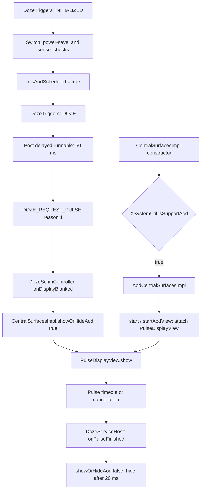

# Lenovo AOD implementation in the Android 17 SystemUI sample

## Scope and evidence

Inspected on 2026-11-15 through the connected JADX instance, starting from
`ForceLenovoAOD.kt`. This is a static implementation survey, not a hook adaptation
or an on-device validation.

Sample identity reported by its manifest:

- Package: `com.android.systemui`
- `versionName`: `17`; `versionCode`: `37`
- Compile/min/target SDK: `37`
- Decompiled source marker: `go/retraceme 18fb1fa2e53ac1eb6d3aabb5731499e5a83dbe8bb2e2198b13e7fc962547dfa7`

The source marker is not an APK checksum or a verified device build number.
Findings below apply to this loaded sample. Java listings are JADX output; no
Java source was added to the Android project.

## Main implementation locations

| Class | Relevant methods | Responsibility |
| --- | --- | --- |
| `com.android.systemui.utils.XSystemUtil` | `isSupportAod()`, `isAodEnabled(Context)` | Hardware property and user switch |
| `com.android.systemui.statusbar.phone.CentralSurfacesImpl` | constructor, `showOrHideAod(boolean)` | Create the Lenovo controller and route pulse visibility |
| `com.android.systemui.statusbar.phone.AodCentralSurfacesImpl` | `start()`, `startAodView()`, `setAodShowing(boolean)`, `onDoubleClick()` | Own the independent AOD window and publish its state |
| `com.android.systemui.aod.doze.view.PulseDisplayView` | `show()`, `getClockType()`, `getLayoutParams(int)`, `onTouchEvent(MotionEvent)` | Render the actual Lenovo AOD UI |
| `com.android.systemui.aod.doze.view.LenovoViewClock` | `initInflateView()`, `updateTime()`, `setCityName()` | Clock layout and time rendering |
| `com.android.systemui.aod.doze.view.LenovoViewClockNumber` / `LenovoViewClockColon` | `inflateView()` | Clock glyph components |
| `com.android.systemui.doze.DozeTriggers` | constructor, `transitionTo(State, State)` | Inlined Lenovo scheduling and sensor checks |
| `com.android.systemui.doze.ZuiDozeTriggers$$ExternalSyntheticLambda0` | `run()` | Delayed request for the initial pulse |
| `com.android.systemui.statusbar.phone.DozeScrimController` | `AnonymousClass1.onDisplayBlanked()`, `onFinished()` | Show AOD when pulse starts and schedule timeout |
| `com.android.systemui.statusbar.phone.DozeServiceHost` | `AnonymousClass1.onPulseFinished()` | Hide AOD when pulse ends |
| `com.android.systemui.aod.setting.AoDSettingActivity` / `AodPreviewActivity` | `onCreate()`, item/apply callbacks | Style selection, preview, and switch persistence |

`com.android.systemui.aod.utils.AodUtil` holds style-name mappings, font loading,
flower/moon resources, and the desk-clock city-name provider call. The modern
`FromAodTransitionInteractor` / `Aod*ViewModel` classes are additional framework
keyguard machinery; the Lenovo view and pulse integration above are the useful
starting points for this feature.

## Creation and display path

`isSupportAod()` returns true only when
`SystemProperties.getInt("ro.config.aod.support", 0) == 1`.
`isAodEnabled(Context)` additionally requires a non-null context and
`Settings.System.getIntForUser(..., "always_on_display", 0, -2) == 1`.

The support check controls controller creation in the `CentralSurfacesImpl`
constructor, view attachment in `startAodView()`, and visibility routing in
`showOrHideAod()`. `PulseDisplayView.show()` checks `isAodEnabled()` again.
A bypass introduced after controller creation was skipped cannot create the
missing controller by itself.

`startAodView()` inflates `R.layout.display_layout_land` and
`R.layout.display_layout`, connects battery callbacks, and attaches the view for
the current orientation through `WindowManager`. `getLayoutParams()` uses a
full-screen window, `type = 2015`, `flags = 25167648`, and title `AOD`;
the controller additionally sets `privateFlags |= 16` and clears fit-inset types.
This is an independent Lenovo view window, rather than just an AOSP clock state.

`show()` makes the view visible and publishes
`Settings.Secure["system_aod_show"] = 1`. The delayed hide runnable makes it
invisible, publishes `0`, and stops clock animation/update flags.

## Scheduling gates and sensor selection

The initialization branch of `DozeTriggers.transitionTo()` checks:

1. The Doze machine and its `mZuiDozeMachine` exist.
2. `XSystemUtil.isAodEnabled(context)` succeeds.
3. Power save is inactive, or
   `Settings.Global["zui_power_save_disable_aod_notification_enabled"] == 0`.
   The setting defaults to `1`; a missing power manager does not block this branch.
4. A cached or discovered vendor motion sensor exists.

Only then does it set `mIsAodScheduled = true`. The sensor search order is:

| Condition | Sensor types, in order |
| --- | --- |
| `ro.config.lgsi.code.base == "qcom"` | `33236547` (ZUI), then `33171017` (AMD) |
| Other or unavailable code-base property | `65621` for a model containing `TB570`, otherwise `65620` (MTK); then ZUI and AMD |

The cached field is `ZuiDozeMachine.mCachedMotionSensor`, and
`ZuiDozeMachine.findSensor(SensorManager, int)` returns the first matching sensor.
In this sample the field's references are scheduling/lookup and clearing it in
`DozeService.onDestroy()`. These references establish an availability gate;
they do not establish a motion-event-driven continuous AOD implementation.

JADX's Java output contains a misleading `break` after reading the code-base
property. The smali confirms that it continues to `:goto_19d`, then branches to
the MTK or ZUI lookup. The sensor order above was checked against smali.
The unconditional `Cannot show AOD` log at the end of the scheduling branch is
also insufficient by itself to prove that scheduling failed.

On entering `DOZE`, the scheduled flag is cleared and a runnable is posted after
50 ms. That runnable requires the machine still to be in `DOZE`, checks the host
and biometric-unlock state, clears `mPulsePending`, and requests
`DOZE_REQUEST_PULSE` with reason `1`.

## Pulse duration and wake-up

`DozeScrimController.AnonymousClass1.onDisplayBlanked()` advances the pulse state
and calls `showOrHideAod(true)`. `DozeServiceHost.AnonymousClass1.onPulseFinished()`
requests `DOZE_PULSE_DONE` and calls `showOrHideAod(false)`.

For reason `1`, `DozeScrimController.AnonymousClass1.onFinished()` posts
`mPulseOut` at the visible duration and `mPulseOutExtended` at twice that duration.
The loaded `res/values/integers.xml` sets `doze_pulse_duration_visible = 6000`.
`DozeParameters.getInt()` permits a `doze.pulse.duration.visible` property override
and constrains the value to 0–60000 ms. Other events can cancel or extend the
pulse. Thus the discovered initial Lenovo AOD path is a timed pulse, not evidence
of permanent always-on display; actual timing still requires device verification.

Double tap follows `PulseDisplayView.onTouchEvent()` ->
`AodCentralSurfacesImpl.onDoubleClick()` -> `DozeHost$Callback.onDoubleClick()` ->
`DozeTriggers.AnonymousClass2.onDoubleClick()` -> `PowerManager.wakeUp()`.
The view requires `Settings.System["double_tap_enable"] == 1`, two up events
within 200 ms, and squared point distance below 10000.

## Settings and style resources

Both activities are exported in the sample manifest and declare a MAIN action:

- `com.android.systemui.aod.setting.AoDSettingActivity`
- `com.android.systemui.aod.setting.AodPreviewActivity`

The setting grid selects `config_aodSupportStylesPhone`,
`config_aodSupportStylesPrc`, or `config_aodSupportStylesRow` according to device
and region. It then filters styles through its preview and name maps. Presence
in an array or drawable set alone therefore does not guarantee a selectable style.
Index zero is the `none` entry and writes `always_on_display = 0`.

The preview apply callback writes the style to both `Settings.System["aod_style"]`
and the private `aod_prefers` preferences, and enables `always_on_display`.
The timezone branch also writes `aod_timezone_style` and city preferences.
`PulseDisplayView.getClockType()` reads the System setting; it explicitly rewrites
`timezone` to `classic` and returns type `1` in this sample despite retained
timezone rendering branches. Preserve host spelling such as `busness`,
`retrodial`, `vividdial`, and `artdial` when tracing persisted values.

## Implications for ForceLenovoAOD

The existing hook expects `ZuiDozeTriggers(DozeTriggers, Context)` and
`mIsGoingToStartAOD`. Neither is present in the inspected dex. Smali confirms that
`ZuiDozeTriggers` contains fields and a static initializer; its construction and
field initialization have been moved into the `DozeTriggers` constructor.
The remaining scheduling field is `mIsAodScheduled`, whose writes and consumption
are in `DozeTriggers.transitionTo()`.

The hook's property and switch interception still matches the strings used by
`XSystemUtil`, but it does not address the power-save gate, motion-sensor gate,
early controller creation, or pulse duration. Simply renaming the field is not
a complete adaptation.

For a subsequent implementation task, the stable, narrow capability entry is
`XSystemUtil.isSupportAod()`; user-switch behavior can be handled separately via
`isAodEnabled(Context)`. Any scheduling adaptation should inspect the actual
`DozeTriggers.transitionTo()` state boundary and must preserve initialization,
power/wake behavior, and pulse cleanup. Device sensor availability and panel
behavior remain unverified. No hook code was changed by this survey.
