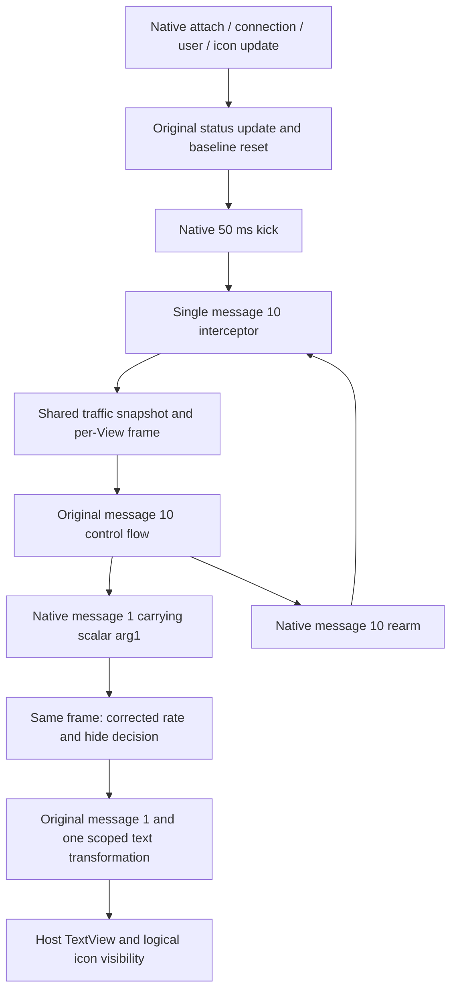

# Network speed refactor plan

Status: analysis and planning complete; implementation has not started.

Evidence date: 2026-11-14. Host evidence comes from the SystemUI APK currently
loaded in Jadx MCP: package `com.android.systemui`, versionName `17`, versionCode
`37`, min/target/compile SDK `37`. Its NetworkSpeedView lives in
`com.android.systemui.statusbar.view`. This proves the current host contract;
the older `com.android.systemui.zui` implementation still needs separate validation.

## Decision

Use one `SystemUINetworkSpeedHook : AppHookModule` as the installation and runtime
owner for all four network speed features. Override `isEnabled()` with the OR of
the four feature switches, then install only the hooks required by the enabled
features in `handleLoadPackage`.

Keep the host NetworkSpeedView, its Handler, its native sample message `10`, and
its native display message `1`. Double-layer output becomes a rendering mode of
the same pipeline. Hide-slow becomes a presentation policy that does not disable
the native sampling loop. Private helpers and a pure Kotlin policy model keep the
owner readable without creating independently registered feature Hook classes.

The existing double-layer Hook already writes into the host NetworkSpeedView;
it does **not** create a separate View. The actual independent path to remove is
its replacement sampling, message payload, scheduling, and formatting logic.

## Evidence and current problems

### Host contract verified through Jadx MCP

Read `NetworkSpeedView` source and smali, its resource layout, and references to
`isIconVisible` / `updateNetworkSpeedViewStatus`. Also read IconManager.addHolder
and StatusIconContainer.onMeasure/onLayout.

| Host member | Verified behavior | Refactor consequence |
| --- | --- | --- |
| NetworkSpeedView | TextView implementing StatusIconDisplayable, DarkReceiver and ConfigurationListener | Reuse the existing View, icon slot, tint and configuration behavior |
| `mNetworkSpeedHandler` | Handler subclass; current runtime name ends in `$3` | Resolve the field type / index, rather than hardcoding an anonymous class number |
| Message `10` | Removes queued `10`; checks `mShowNetworkRealtimeSpeedState`; stops for airplane mode with neither Wi-Fi nor network; otherwise samples and sends `1`, then rearms `10` after 3000 ms | Keep native control flow and one native rearm per View |
| Message `1` | Uses `arg1` as B/s, formats `number\nunit`, calls TextView.setText | Correct the scalar and transform its text in the same display transaction |
| Native rate calculation | Casts the Long byte delta to Int **before** dividing by 3 | Scaling arg1 cannot repair overflow; compute rates from Long counters instead |
| `getCurrentTotalBytes()` | Total RX + TX minus RX + TX on `lo` | Align all display modes and hide decisions on this traffic definition |
| `updateNetworkSpeedViewStatus()` | Reads the real setting, updates `mShowNetworkRealtimeSpeedState`, resets the byte baseline, sets GONE/VISIBLE and starts a 50 ms kick when enabled | Treat it as a lifecycle/reset boundary; never invoke it on every sample |
| `isIconVisible()` | Reads `network_realtime_speed_state` for the current user | Apply hide-slow here without falsifying the underlying setting |
| StatusIconContainer | Measures and allocates icon slots using `isIconVisible()` and its other block/ignore policies | View visibility alone is insufficient; update logical icon visibility too |
| IconManager.addHolder, type `6` | Inflates status_bar_networkspeedview, assigns the slot, updates status, adds the View with WRAP_CONTENT params | No replacement View or custom icon insertion is necessary |
| Host XML | Two-line TextView style, 8 dp text, 0.8 line spacing, 23 dp initial width | Validate both-line width, height, font scaling and the actual parent params |
| Configuration change | Host resets text size and typeface | Reapply derived style from the host baseline; do not multiply an already modified size |
| Attach / detach | Registers/unregisters host callbacks and removes message `10` on detach | Follow host lifecycle and release module state on detach |

`mIsScreenOff` is reset in the native airplane-mode branch in this APK. Its name
alone does not prove an actual screen-off lifecycle; test screen-off behavior
instead of assuming this field implements it.

The current SettingsObserver only registers the airplane-mode URI on attach;
its network-speed URI branch contains no refresh operation. Do not invent a new
settings observer as part of this refactor. Validate system-toggle behavior via
the existing icon-manager path and native callbacks on device.

### Repository behavior verified in the working tree

| Existing implementation | Problem to remove |
| --- | --- |
| [NetworkSpeedRefresh](../../app/src/main/java/com/qimian233/ztool/hook/modules/systemui/statusbar/NetworkSpeedRefresh.kt) | Independently resolves/hooks the Handler, rescales already truncated arg1, rewrites delayed messages, and exits early when double-layer is enabled |
| [SystemUINetworkSpeeddoublelayerHook](../../app/src/main/java/com/qimian233/ztool/hook/modules/systemui/statusbar/SystemUINetworkSpeeddoublelayerHook.kt) | Short-circuits messages 10/1; maintains three per-View weak maps; puts LongArray in Message.obj; uses wall time and whole-second division; always reads the stored interval regardless of its enable switch |
| [NetworkSpeedHideSlowHook](../../app/src/main/java/com/qimian233/ztool/hook/modules/systemui/statusbar/NetworkSpeedHideSlowHook.kt) | Samples traffic independently, falsifies Settings.System reads process-wide, tracks constructor calls without deduplication, and runs a recurring watcher to restart sampling after hiding stopped it |
| [SystemUINetworkSpeedSizeHook](../../app/src/main/java/com/qimian233/ztool/hook/modules/systemui/statusbar/SystemUINetworkSpeedSizeHook.kt) | Hooks TextView.setText separately and treats any two-line text as number/unit, including double-layer upload/download text; discards existing spans |
| [SystemUiDexIndexer](../../app/src/main/java/com/qimian233/ztool/dexindex/indexer/SystemUiDexIndexer.kt) | Network-speed Handler index only matches the old View package, and is named after double-layer despite describing shared host infrastructure |

There are two independently installed Handler.handleMessage hooks, not four.
Hide-slow uses a separate Handler/Runnable watcher, and size hooks TextView.
The refactor addresses both hook-chain competition and the separate runtime loops.

The working tree already contains user edits to NetworkSpeedHideSlowHook and
TODOS.md. This planning change does not modify or commit them. Implementation
must account for the current user edits before retiring the old Hook.

## Feature and installation matrix

Abbreviations: `S` = number/unit size, `D` = double-layer, `R` = custom refresh,
`H` = hide-slow. Threshold and hide-both are parameters of H, not activation keys.

```kotlin
override fun isEnabled(): Boolean = readOptions().let {
    it.size || it.doubleLayer || it.customRefresh || it.hideSlow
}

val options = readOptions()
val needsHandler = options.doubleLayer || options.customRefresh || options.hideSlow
val needsText = options.size || options.doubleLayer
```

This is illustrative pseudocode. Read remote preferences through the project
base class and use PreferenceKeys constants and registered defaults exclusively.
Preference read failure disables installation or passes through an existing hook.

| Enabled capability | Installed hook groups |
| --- | --- |
| All off | None |
| S only | Shared NetworkSpeedView resolution and one scoped TextView.setText hook; no sampling or scheduling hook |
| D or R or H | One Handler.handleMessage hook, shared sampling/frame transport, status/reset and detach hooks |
| D | Shared text transformation and host-style lifecycle hooks |
| R | Scoped rewrite of native message-10 rearm; only install after rate correction is usable |
| H | NetworkSpeedView.isIconVisible and presentation application after native status/display updates |
| Any combination | Union of the above; each target is installed once by the owner |

Use `getTargetPackages() = arrayOf(ScopeKeys.SYSTEM_UI.packageName)`.
For `getModuleName()`, retain
`PreferenceKeys.SYSTEMUI_NETWORK_SPEED_DOUBLELAYER.name` as the legacy owner
identity, including the existing DexIndex namespace. Its boolean does not gate
the owner after the override. This avoids a new user preference or master switch.
Log each installed capability explicitly so the legacy identity is not mistaken
for evidence that double-layer is enabled. A future statistics mapping must use
capabilities, not infer active features solely from this owner name.

Keep all seven preference keys, defaults, UI setting ids, search entries and
backup formats stable. In particular:

| Setting | Resulting semantics |
| --- | --- |
| Number/unit size | Native mode: number 1.3x, unit 0.9x. Double-layer mode: apply these spans to each line's numeric and unit segments, never to the entire upload/download lines |
| Double-layer | Upper line `▴ upload`, lower line `▾ download`, both on the host TextView; preserve the existing B/K/M/G units and precision policy |
| Custom refresh enabled | Use the stored interval for the common loop, with the existing 0.5–60 s backend bounds and 0.5–10 s UI range |
| Custom refresh disabled | Use native 3000 ms, even if a non-default interval remains stored and D is enabled |
| Hide-slow | Compare download against threshold; continue sampling while presentation is hidden |
| Threshold | KB/s means 1024 B/s; keep comparison strict `<`, so a zero threshold never hides valid nonnegative rates |
| Hide-both | Only when H is enabled: hide if download **and** upload are each below threshold; independent of display mode |

Treat non-finite or malformed floats as their registered defaults before clamping.
Default threshold remains 10 KB/s. S and D compose through one semantic formatter;
the double-layer constructor's current 1.1x font adjustment must be derived from
the host baseline and reapplied after configuration changes, without compounding.

## Shared runtime pipeline



### Resolution and state ownership

Keep a private resolved-host descriptor in the owner: View class, Handler class,
Handler/owner fields, status method and native total-byte getter. Resolve once
at installation, never in high-frequency callbacks.

Try the current and legacy View class names by actual class availability. For
the Handler, validate the offline index against the selected View and declared
Handler field; otherwise inspect that field's type, then try a bounded anonymous
class fallback. Require Handler assignability, handleMessage(Message), and a
verifiable owner relationship. An arbitrary class with handleMessage is insufficient.

Update the existing offline index to match both package names and keep its legacy
module/key namespace. No schema bump is needed merely to broaden this query;
the corrected APK index must nevertheless be regenerated through the manual
refresh entry for users whose cached host fingerprint has not changed. If the
index schema is extended later, bump its schema version then.

Maintain one weak per-View state containing baseline counters/timestamp, generation,
last valid frame, slow decision and original style metrics. Do not put a strong
reference to the weak-map key or its Handler in the value. Constructor hooks are
unnecessary for traffic state: initialize lazily from status/Handler callbacks.
Attach/configuration hooks, when needed for D styling, must be idempotent.

Use SystemClock.elapsedRealtime and millisecond precision:
`rateBps = deltaBytes * 1000.0 / elapsedMs`. Keep Long counters and Double/Long
rates until converting to native arg1; clamp the final native scalar to Int range.
Do not attempt to undo the host's overflowing Long-to-Int cast by multiplying arg1.

Read total RX/TX and loopback RX/TX into one immutable traffic snapshot. The same
snapshot supplies download, upload, combined speed and hide decisions. Reuse a
snapshot for View callbacks at the same measurement instant; keep baselines per
View so differently timed handlers do not corrupt each other's windows. No
arbitrary one-second throttle may suppress the supported 0.5-second setting.

Unsupported counters, read failures, negative deltas, clock anomalies and invalid
baselines produce an invalid frame and a new baseline, rather than a fabricated
slow state. Initial/restart kicks are warm-up frames; preserve the previous valid
presentation, or zero at first use, until a normal sample is available.

### Message 10: preserve native control flow

Enter a scoped sampling context for this View/Handler, obtain its snapshot and
candidate frame, then call `chain.proceed()` exactly once. Always let native
enablement, airplane-mode handling, queue cleanup and rearm decisions execute.
Do not substitute isIconVisible for the native sampling gate.

Install a narrowly scoped hook on the host's `getCurrentTotalBytes()` to return
the context's already collected combined counter during message 10. This avoids
the native method performing repeated RX/TX/loopback reads within one sample and
keeps the host baseline consistent with the shared frame. Outside this context,
the getter executes normally. Resolve and validate it before activating this
optimization; if unavailable, native reads may remain while the common snapshot
still serves all module features.

The existing host sends a native Message through Handler.sendMessage(Message).
Intercept this transport only for the resolved Handler while inside its sampling
context, and only for `what == 1`. Associate that Message identity with the immutable
frame and View generation in a side table; remove the association on consumption
or failed enqueue. Do not replace Message.obj with a LongArray. Discard stale
generation associations after status resets or detach; recycled Message objects
must never retain a previous frame association.

### Scheduling: one narrow intervention

For R, hook Handler.sendEmptyMessageDelayed once and change the delay only when
the receiver is the selected network-speed Handler, `what == 10`, the call is
inside its original sampling context, and the requested delay is native 3000 ms.
This is a known native rearm call, rather than the existing `delay >= 1000` heuristic.
The status update's 50 ms kick, other messages and every unrelated Handler pass
through. Do not enqueue a second tick from the module.

Use the measured interval, not the configured delay, for speed calculation.
An overloaded Looper, a native baseline reset or a configuration change must not
scale the reported rate. If frame correction/transport cannot be installed, leave
R on native 3 s and log the capability degradation.

### Message 1: one frame, one text write

Retrieve its associated frame. For valid frames set arg1 to the nonnegative,
bounded combined B/s. Keep native number/unit formatting when D is off.
Compute H from that same frame, not from a second TrafficStats read.

Execute original message 1 under a display context. A single TextView.setText
interceptor transforms only the selected NetworkSpeedView instance. When D is
enabled it produces upload/download text from that context's frame; S applies
spans to semantic numeric/unit segments for either mode. Build Spannable text
directly and retain unrelated spans; remove the HTML conversion and newline-only
classification. Pass the transformed text to the original setText once, rather
than writing native text and immediately overwriting it.

Native zero/reset text outside message 1 also needs a defined D presentation:
render both zero lines when no valid frame exists, using the scoped View state;
never reuse stale traffic from another View or from an earlier lifecycle.
On a missing/invalid frame, keep native behavior and the last valid slow decision
instead of hiding because a sample failed.

If sampling remains unavailable while R is requested, return scheduling to native
3 s until a valid baseline/frame is restored. Passing through native arg1 while
continuing a custom interval would recreate the original rate error. On recovery,
restart the measured baseline before resuming custom scheduling; D falls back to
native text while no usable frame exists. Transient warm-up/reset frames use the
explicit zero/previous-presentation policy above.

### Hide-slow: separate sampling eligibility from presentation

After original status/display processing, apply presentation visibility from real
native enablement and the cached slow decision. Preserve the original
`mShowNetworkRealtimeSpeedState`; GONE due to H must not stop message 10.

Intercept NetworkSpeedView.isIconVisible and return
`originalResult && !(hideSlowEnabled && cachedSlow)`. Its callback only consults
cached state; it never samples traffic or reads the offline index. Keep the parent
container's block/ignore/overflow policy intact.

On slow/fast transitions, update the host View visibility and request layout so
StatusIconContainer releases/restores the slot. Reapply H after native status
updates that would otherwise set VISIBLE. Never call the status updater just to
hide/show: that resets the sampling baseline and recreates the 50 ms kick.

Consequently, no process-wide Settings.System hooks, hide watcher, independent
timer, or constructor-collected refresh list remains. System disablement and
detach still stop sampling via native behavior. Recovery while hidden is detected
by the same next native sample, for either display mode.

## Migration and failure behavior

Installation uses stable, explicitly namespaced hook ids; no generic duplicate
`handle_message` / `set_text` registrations remain. Keep every new handler-facing
hook inside the unified owner. Validate dependency groups before installing their
effects, and retain HookHandles to undo a partially installed capability group.
An unavailable host method disables only dependent capabilities, where possible.

Callbacks must distinguish installation options from current settings. Only
initially selected groups are installed; existing callbacks can safely pass
through after their feature is turned off. Enabling a previously uninstalled
group requires the existing scope reload/restart workflow. Reading a new boolean
alone cannot install a missing hook.

On a feature-disable transition, restore its derived presentation before entering
steady pass-through: remove module spans/size adjustments, release H's hidden
state while respecting native enablement, and clear stale frame state. Perform
this on the View's Looper at the next existing callback, or through the existing
scope reload workflow; do not create a periodic preference listener. Restoring
only callback behavior would leave an already modified View styled or hidden.

At hot reload, existing Views/Handlers survive. Resolve state lazily and treat the
first frame as a fresh baseline. HookInit already replays new hooks and unhooks
the previous generation's HookHandles. The old hide watcher is a Runnable and is
not removed by unhooking; the initial migration from the old implementation must
use a SystemUI restart so it cannot survive in the new generation. Do not claim
that replacing HookHandles cleans that legacy timer. Subsequent generations of
the new design have no module-owned recurring task to leak.

Prefer native-message cooperation. If a supported host version cannot expose a
usable message/frame contract, disable the dependent mode with a diagnostic and
retain native display; do not keep the old double-layer implementation as a second
engine. A replacement message-10 implementation, if later proven necessary, must
be a shared adapter for all modes with separately verified native gates/lifecycle.

## Implementation sequence

These are future implementation tasks, not changes made by this planning commit.

1. [ ] Add the unified owner and pure Kotlin options/snapshot/frame/format policy. Implement resolution, feature OR and the installation matrix; keep native behavior initially.
2. [ ] Add shared message-10 sampling, frame association and message-1 Long-based rate correction. Validate warm-up, resets, stale messages and unrelated receivers.
3. [ ] Move custom refresh into the owner, strictly filtering native rearm. Verify 0.5/1/3/10 s and stored interval with R disabled.
4. [ ] Move double-layer and S into the single text renderer; validate both-line spans, zero text, configuration reapplication and host width/height.
5. [ ] Move H and its parameters into the shared frame/presentation policy; remove global settings interception and watcher after recovery/layout validation.
6. [ ] Replace the four old registrations/classes atomically; broaden the offline Handler index and manually regenerate it on the test device. Preserve user edits and migrate relevant reverse-engineering comments into this research document.
7. [ ] Run focused policy tests, assembleDebug and the on-device matrix using assembleDev. Confirm there are no duplicate native rearms or module-owned recurring tasks.
8. [ ] Review diff/check staged changes, commit the implementation, record verification results, and archive the completed implementation plan only when every task is complete.

Expected implementation footprint: four retired Hook files, the unified Hook,
one pure Kotlin policy file, HookManager, SystemUiDexIndexer and one focused test
file (nine code files). Keep resolution and small lifecycle adapters private to
the owner initially; splitting them later must not create new registered owners.
UI, Repository/ViewModel and PreferenceKeys require no behavior wiring changes
for this plan. If implementation expands beyond ten changed files, write the
required execution checklist at the repository root before that expansion.

## Verification and acceptance

Unit tests must check meaningful behavior: fractional-second rates; Long deltas
above Int range; unavailable/reset counters; zero and strict threshold boundaries;
H download-only versus both-directions; disabled R ignoring stored interval;
formatter segment ranges and invalid interval fallback. Host Hook behavior needs
on-device verification, not tests that merely repeat hook-installation code.

| Scenario | Acceptance |
| --- | --- |
| All 16 S/D/R/H switch combinations | Expected hook-group union, one handler owner, one text transformation; parameters do not activate groups on their own |
| Native and D at 0.5/1/3/10 s | Fractional-second updates work; comparable B/s for the same traffic and window; no double correction |
| R off with stored 0.5 s, D on | Native 3 s rearm |
| H slow to fast while hidden | Automatic recovery at the next shared sample; no watcher; no occupied icon gap |
| Upload-only traffic | Download-only H hides; hide-both stays visible when upload exceeds threshold, in either mode |
| Loopback-only traffic | Excluded consistently from native, D and H counters |
| Real system switch off/on | Off does not get overridden by H or D; on follows the existing host update path without a second loop |
| Airplane / Wi-Fi / reconnect / user change | Native gates preserved; shared baselines reset without spikes or stale decisions |
| Header/status bar, multiple instances | Existing Views/slots reused; independent sample windows; no duplicate instance registration |
| Dark/light, rotation, font scale, long G/s values, RTL | Host tint preserved, size reapplied without accumulation, both lines readable and correctly measured |
| Looper delays / screen off/on / detach-reattach | Measured elapsed time used; stale messages do not overwrite a new generation; no work created after detach |
| First migration restart and later hot reload | No surviving old watcher; existing Views initialize lazily; disabled groups pass through or are removed by reload |
| Current host and an older ZUI host | Validate contracts separately; an unavailable capability falls back to native behavior with a bounded diagnostic |

Run `git diff --check` for this documentation-only change. Implementation must run
`.\gradlew.bat assembleDebug` and focused unit tests. Device verification with
LSPosed must build/install `app-dev.apk` using `.\gradlew.bat assembleDev`.
Run the unused-string checker and SearchIndexConsistencyTest only if implementation
also adds/moves/renames strings or setting rows. Measure CPU and allocation under
the same traffic and View count; retain the existing 0.5 s floor and do not claim
an improvement solely from reducing Hook class count.

Planning acceptance is satisfied by the verified current-host contract, complete
feature matrix and executable migration/verification sequence above. Runtime
feasibility and older-host compatibility remain implementation validation gates.
